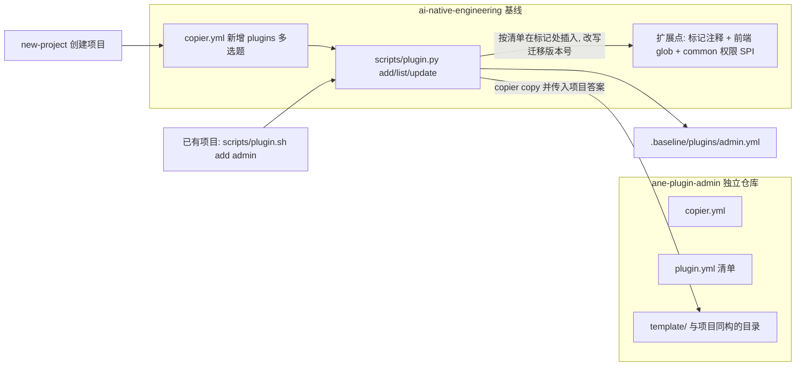

# 基线插件机制与第一个插件 ane-plugin-admin（RBAC）

| 项 | 内容 |
| :--- | :--- |
| 提出人 / 项目 | wanghuan / 基线维护组 |
| 日期 | 2026-11-09 |
| 类型 | 骨架 / 模板 |
| 状态 | 待评审 |
| 已确认的决定 | 插件以源码注入方式进入项目（包名跟随项目）；admin 插件只做 RBAC 核心；RuoYi-Vue / RuoYi-Vue3 只作参考 |

## 遇到的问题

基线生成新项目时，经常需要附带一些可选的完整功能，例如基于 RBAC 的后台权限管理、手机 APP、微信小程序、地图服务组件。现在只能用 `copier.yml` 里的开关加 `` 目录实现（如 `enable_screen`），有三个问题：

1. 每加一个功能，基线模板就膨胀一次，所有功能的代码都由基线维护组负责。
2. 只能在创建项目时选择，项目建好之后不能再加。
3. 功能之间、功能与业务模块之间没有约定的接入方式，每次都要临时改共享文件。

目标：把"按需引入功能"做成基线的通用插件机制，创建项目时可以勾选，项目建好之后也可以再加；然后按主项目技术栈和规范重写第一个插件 `ane-plugin-admin`。

## 对原思路的判断

方向是对的，但有几处要先解决，否则做出来的是一次性复制粘贴，而不是可复用的插件。

1. **这不是改名，是重写。** RuoYi 用的是 MyBatis + PageHelper + Druid + fastjson + Redis + `AjaxResult`；主项目强制 JPA + Flyway + Spring Modulith + 契约先行（OpenAPI 生成接口）+ MapStruct + ProblemDetail + 雪花 ID + 软删除审计字段 + 三种数据库方言。RuoYi 只能当业务参考（表结构、权限模型、页面交互），代码要按主项目规范重写，并通过 Spotless、Checkstyle、SpotBugs、ArchUnit 和覆盖率门禁。前端同理：RuoYi-Vue3 是 JS + 自带布局，主项目是 TS + Pinia + 契约生成的 `api-client`。
2. **只解决了 admin，没解决插件机制。** 先做通用机制，admin 只是第一个插件。
3. **插件会改共享文件。** 加一个插件要动父 pom 的 modules、`app/pom.xml` 的依赖、前端路由和菜单、`application.yml`、compose。Copier 一个模板不能修改另一个模板生成的文件，所以基线要预留扩展点。现在只有 `@modules-end`、`@module-deps-end` 两个标记，不够。
4. **权限是横切关注点。** 装了 admin 之后所有接口要鉴权，`example` 模块和 `ApplicationIT` 会立刻失败；业务模块如果直接依赖 admin 的类，没装 admin 的项目就编译不过。需要在 `common` 里放一个不依赖任何安全框架的权限注解，由 admin 插件实现。
5. **迁移脚本的版本号。** 插件迁移脚本如果写死版本号，项目上线一段时间后再加插件，Flyway 会因为版本早于已执行的脚本而拒绝执行（out-of-order）。插件安装时要把迁移脚本的版本号改写为安装时刻。
6. **源码注入的代价。** 代码进入项目后归项目所有，认证代码的安全修复需要能推到各项目。对策：插件本身是 Copier 模板并记录答案文件，用 `copier update` 做三方合并升级。
7. **Copier 的限制。** Copier 的 Git 地址不能指向仓库的子目录，所以插件要以独立仓库（`ane-plugin-admin`）打标签发布；开发期用本地路径。
8. **RuoYi 是 MIT 协议**，可以参考和改写，在插件 README 中保留来源声明。

不采用的替代方案：

- 运行时插件（PF4J、OSGi、微前端）：对这个场景太重。
- Maven / npm 制品依赖：包名固定、需要内网私服，已排除。如果将来多个项目都要求统一修复安全问题且内网都有私服，可以再评估把认证核心改成制品。

## 建议的改法

### 整体架构



两种引入方式走同一条路径：创建项目时勾选，或者项目建好之后执行 `scripts/plugin.sh add admin`（Windows：`scripts\plugin.cmd add admin`）。升级用 `scripts/plugin.sh update admin <版本>`。

### 基线的一次性改造（扩展点）

- `copier.yml`：新增 `plugins` 多选题（Copier 9 支持 `multiselect`），`_tasks` 在 `bootstrap.py` 之后为每个选中的插件调用 `plugin.py add`。
- `template/scripts/plugin.py`，以及 `.sh`、`.cmd`、`.ps1` 启动脚本，写法与 `new-module` 一致：
  - 读取 `.baseline/copier-answers.yml`，把 `project_code`、`package_name`、`package_path`、`dialects` 传给插件模板；
  - 校验插件清单 `plugin.yml` 中声明的基线版本范围和依赖插件；
  - 在标记处幂等插入内容，重复执行不会重复插入；
  - 把插件迁移脚本的版本号改写为安装时刻；
  - 把答案记录到 `.baseline/plugins/<name>.yml`。
- 补充标记：`application.yml` 中加 `# @plugin-config-end`，`deploy/local/compose.yaml` 中加 `# @plugin-services-end`。
- 前端改为约定发现，减少对文件的修改：
  - `frontend/apps/admin/src/router/index.ts` 和 `main.ts` 用 `import.meta.glob('./plugins/*/index.ts')` 加载插件，每个插件导出 `install({ app, router })`；
  - `BasicLayout` 的菜单改为可替换的数据源：默认取静态路由的 `meta`，装了 admin 后取后端返回的菜单。
- `common` 中新增权限 SPI：
  - `@RequiresPermission("example:note:list")` 注解和 `PermissionChecker` 接口，默认实现全部放行；
  - `CurrentUser` 保持不变，由 admin 的认证过滤器负责设置；
  - 业务模块只依赖 `common`，有没有装 admin 都能编译。
- 测试：`ApplicationIT` 和示例 IT 改为在有安全组件时使用插件提供的测试登录支持。
- `bin/selftest.sh`：增加"带 admin 插件"的组合，分别在 PostgreSQL、达梦、人大金仓三种画像下运行，并验证"先创建项目、再加插件"的路径。
- 手册：新增"插件开发指南"（清单格式、扩展点、目录约定、门禁要求）。

### ane-plugin-admin 设计（RBAC 核心）

**范围**：用户、角色、菜单/按钮权限、部门、岗位、数据权限、登录认证（JWT）。不包括字典、参数、日志、定时任务、代码生成、监控。

**位置**：`plugins/admin/ane-plugin-admin/` 作为独立的 Copier 模板开发，之后拆成独立仓库发布。`plugins/admin/RuoYi-Vue`、`plugins/admin/RuoYi-Vue3` 只作参考，不进入发布物，不提交到基线仓库（加入 `.gitignore`）。

```
ane-plugin-admin/
  copier.yml            # 问题: 初始管理员账号、JWT 有效期、是否启用数据权限
  plugin.yml            # 名称、版本、基线版本范围、要插入的 module/依赖/配置
  template/
    backend/modules/admin/...          # 包名 {{ package_name }}.admin
    contracts/openapi/admin.yaml
    db/migration/{postgresql,dm,kingbase}/V__admin_*.sql
    frontend/apps/admin/src/plugins/admin/...
    .ai/rules/60-admin-rbac.md         # 告诉 AI 怎样给新接口加权限、加菜单
    docs/context/admin.md
```

**命名对照**（RuoYi 到 ANE）：

| RuoYi | ANE |
| :--- | :--- |
| `ruoyi-system` + `ruoyi-framework` 安全部分 | `modules/admin`，构件名 `<项目代号>-module-admin`，包分层 `api` / `domain` / `service` / `web` / `security` |
| `SysUser` / `sys_user` 等 | `User` / `adm_user`；`adm_role`、`adm_menu`、`adm_dept`、`adm_post`、`adm_user_role`、`adm_role_menu`、`adm_role_dept`、`adm_user_post` |
| `LoginUser` | `AdminPrincipal` |
| `TokenService` | `JwtTokenService` |
| `SecurityUtils` | `common` 的 `CurrentUser` |
| `@ss.hasPermi(...)` | `@RequiresPermission(...)` |
| `RuoYiConfig` | `AdminProperties`，配置前缀 `ane.admin` |
| `AjaxResult`、`TableDataInfo` | 契约生成的 DTO、`Pagination`、ProblemDetail |
| `@DataScope`（拼接 SQL） | JPA `Specification` 或 Hibernate Filter |

补充约定：

- 所有实体继承 `BaseEntity`，使用雪花 ID、审计字段和软删除。
- 默认不引入 Redis：无状态 JWT，加数据库中的刷新令牌和注销黑名单表；验证码作为可选项。
- 前端放在 `src/plugins/admin/`，TS 编写：登录页、用户/角色/菜单/部门/岗位管理页、`v-perm` 指令、`useAuthStore`、根据后端菜单树生成动态路由、请求拦截器挂载令牌。接口调用一律使用由 `admin.yaml` 生成的 `api-client`。
- 业务模块只使用 `common` 里的 `@RequiresPermission`。新模块的菜单和权限点通过迁移脚本中的种子数据声明。Modulith 规则保证其他模块只能依赖 `admin.api` 包。

### 后续插件如何套用

- 模块型插件（地图服务、消息、文件存储）：与 admin 一样，提供后端模块、契约、迁移脚本和前端 `plugins/<name>`。
- 应用型插件（手机 APP、微信小程序）：在 `frontend/apps/<name>` 下新增一个应用，复用 `api-client` 和契约；需要登录时在清单中声明依赖 `admin`。
- 两类插件共用同一份清单格式和 `plugin.py`，基线不需要再改。

## 实施任务

按顺序执行，前一项验收通过再开始下一项。

| 序号 | 任务 | 验收标准 |
| :--- | :--- | :--- |
| 1 | 决策记录：在 `handbook/` 中写插件机制说明（源码注入、独立 Copier 模板、清单格式、扩展点列表） | 维护组评审通过 |
| 2 | 基线扩展点：补充标记、前端插件加载与可替换菜单、`common` 权限 SPI | 不装插件时生成的项目与改造前行为一致，`bin/selftest.sh all` 通过 |
| 3 | `plugin.py` 及三种启动脚本；`copier.yml` 增加 `plugins` 多选题 | `add` 重复执行不产生重复内容；迁移脚本版本号为安装时刻；答案文件已记录 |
| 4 | 最小示例插件（一个后端模块 + 一个前端页面 + 一个迁移脚本），接入 selftest | 创建时引入、创建后引入、升级三条路径在 macOS 和 Windows 入口下都通过 |
| 5 | admin 后端：契约、三种方言迁移脚本、实体与仓储、JWT 认证、RBAC、数据权限、测试 | `verify full` 通过；三种画像下集成测试通过；覆盖率不低于基线要求 |
| 6 | admin 前端：登录、动态路由与菜单、`v-perm`、五个管理页 | 前端 lint、类型检查、Vitest 通过；登录到权限生效的主流程有端到端测试 |
| 7 | 集成：`example` 模块加权限示范、`ApplicationIT` 适配、selftest 三画像矩阵、`.ai` 规则、插件开发指南、官网说明 | `bin/selftest.sh all` 覆盖"无插件"和"带 admin"两种组合并全部通过 |

## 执行约束（给执行者）

1. 严格按"实施任务"的顺序做。任务 4 的三条路径没有全部跑通之前，不要开始写 admin。
2. 每完成一项任务，运行 `bin/selftest.sh all`，结果贴在提交说明或任务记录里；带 admin 的组合要在 PostgreSQL、达梦、人大金仓下都跑。
3. 每项任务单独提交，提交信息遵循仓库的 commit-msg 规范，方便逐项评审和回退。
4. RuoYi 只能当参考，不能整段复制代码，也不能引入 MyBatis、PageHelper、Druid、fastjson、Redis 等主项目技术清单以外的依赖。需要引入清单外依赖（如 JWT 库、Spring Security）时，在决策记录中写明理由。
5. 不修改现有门禁规则来让代码通过（不放宽 Checkstyle、SpotBugs 排除项、覆盖率阈值，不删测试）。
6. 遇到本提案没写到的取舍（例如是否引入 Redis、是否做验证码、数据权限用 Specification 还是 Hibernate Filter），停下来询问提出人，不要自行决定。
7. 不提交 `plugins/admin/RuoYi-Vue`、`plugins/admin/RuoYi-Vue3`。

## 评审意见

